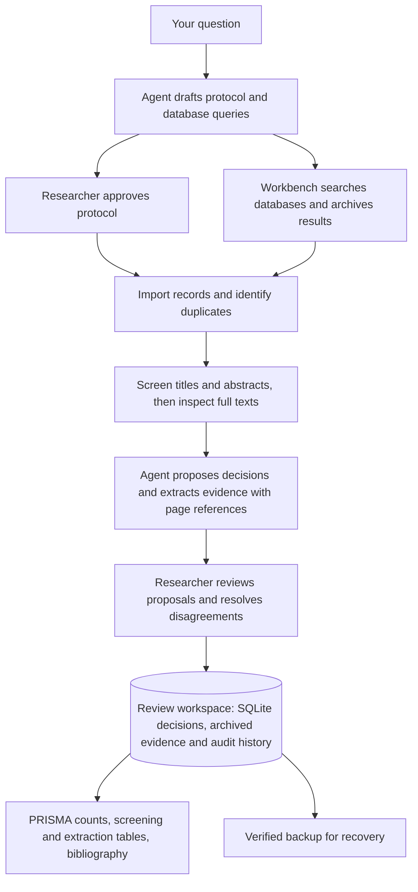

# Systematic Literature Review

Guide a literature review from a research question to a traceable set of findings. The skill gives your agent review instructions and a Python workbench. You can also use it for a smaller task, such as piloting a search or reading one PDF.

## How a review works



The diagram follows a formal review. Discovery and standalone PDF reading can start immediately. Optional semantic ranking orders the screening queue. The researcher decides which papers qualify.

## Get started with your agent

For Codex, run this from the project where you want the skill available:

```sh
git clone https://github.com/xtobando/slr-skill.git .agents/skills/systematic-literature-review
```

Start a new session and ask:

> Use the systematic-literature-review skill. Help me set it up in this environment, run its version and doctor checks, then draft a search plan for my research question. Tell me if my chosen features need an additional download or account.

The model in your agent environment can walk you through the entire setup, locate the installation, run checks with its terminal tools, and help enable the features you choose. With uv installed, the bundled lockfile handles Python and the core libraries on first use. Keep the review workspace separate from this folder. Enter private credentials and confirm scientific decisions in your own terminal.

| Task | What you need |
| --- | --- |
| Plan searches, import saved records, read text PDFs, render pages and export results | Core installation. First-time downloads need internet access. |
| Search online or fetch a public PDF | Network access. Some databases require credentials or a subscription. |
| Rank papers by semantic similarity | FastEmbed and model weights, or a running Ollama embedding model. |
| Use advanced document conversion or a semantic evidence index | Docling for conversion, or Chroma and sentence-transformers for indexing and retrieval. Models may require additional downloads. |

See [setup and installation for other agents](references/setup.md), [search and ranking](references/find-papers.md), [PDF reading](references/read-pdf.md), [review decisions](references/run-review.md), and [reporting and recovery](references/reporting.md).

## Release verification

On Windows with Python 3.11 and the bundled uv lockfile, all 41 command help screens loaded and all nine database adapters produced dry-run plans. Live searches returned records from Crossref, PubMed, arXiv and Semantic Scholar. Crossref refresh and OpenAlex forward and backward citation searches also returned records. FastEmbed scored a PubMed abstract. Public arXiv PDF retrieval, local text extraction, page rendering and cropping completed successfully.

A fresh review produced reports and passed SQLite integrity checks after backup, verification and restore. Those exports used an empty decision history. An end-to-end human screening and adjudication cycle, credentialed providers, Ollama, Docling and Chroma still need separate validation. DBLP recorded a connection failure during the live check. Inspect each search manifest before interpreting a missing result as zero papers.
